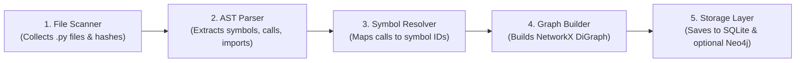

# Codebase Intelligence — Project Overview & Architecture

## 1. What is this project?

**Codebase Intelligence** is a local developer tool that analyzes Python codebases. Think of it as a **lightweight static analysis engine and code graph generator** for your repositories. 

Instead of treating code as plain text files, it parses Python source code, understands how functions, classes, modules, and imports connect to each other, and builds a **dependency graph**. 

With this graph, you can instantly answer questions like:
- *"If I change this function, what other parts of the codebase will break?"* (**Impact Analysis**)
- *"Which tests should I run to verify my changes?"* (**Test Recommendation**)
- *"Is there dead or unreferenced code in this project?"* (**Dead Code Detection**)
- *"How risky is this set of changes?"* (**Risk Analysis**)

---

## 2. What Does It Do? (Core Features)

| Feature                           | What it does                                                              | How it helps                                                           |
| :-------------------------------- | :------------------------------------------------------------------------ | :--------------------------------------------------------------------- |
| 🔍 **Symbol Search & Inspection** | Finds functions, classes, and methods across the whole repository.        | Jump to definitions, view signatures, inspect callers and callees.     |
| 🕸️ **Dependency Graph**          | Constructs a directed graph of modules, definitions, imports, and calls.  | Visualizes and queries how symbols call and import each other.         |
| 💥 **Impact Analysis**            | Traces multi-hop dependency paths backwards from a changed symbol.        | Prevents regressions before modifying shared utility code.             |
| 🧪 **Test Selection**             | Matches changed code to relevant test cases in `test_*.py`.               | Runs only the relevant tests instead of the entire test suite.         |
| 🧹 **Dead Code Detection**        | Flags functions and classes that have 0 incoming calls or imports.        | Helps clean up legacy or unused code safely.                           |
| ⚠️ **Risk Scoring**               | Combines dependency depth, git co-change history, and unresolved symbols. | Gives a composite risk score (Low / Medium / High) for a pull request. |
| 🔒 **Isolated Databases**         | Stores data in isolated SQLite files per repository.                      | Allows indexing multiple repositories without data contamination.      |

---

## 3. How It Works (The 5-Step Pipeline)

Whenever a repository is indexed, the code goes through this pipeline:



1. **Scan & Hash**: Finds all `.py` files and hashes their contents. If a file hasn't changed since the last run, indexing is skipped.
2. **AST Parsing**: Uses Python's built-in `ast` module to extract classes, functions, `import` statements, and function calls.
3. **Symbol Resolution**: Connects the dots! It figures out whether `self.calculate()` refers to a method on the same class, an imported function from another file, or an aliased module.
4. **Graph Construction**: Constructs a directed graph (`NetworkX`) where nodes are symbols/modules and edges represent relationships (`defines`, `imports`, `call`, `attribute`).
5. **Storage**: Saves all indexed symbols, references, and edges into a dedicated local SQLite database (`.codebase-intelligence/repositories/<repo>/<hash>.db`). Optionally pushes graph edges to **Neo4j** if configured.

---

## 4. Architecture & Directory Structure

```text
Codebase-Intelligence/
├── analyzers/               # Code parsing layer
│   ├── base.py              # Base analyzer class & ignore rules
│   └── python/              # Python AST visitors
│       ├── parser.py        # Orchestrates visitors on each file
│       ├── symbols.py       # Extracts classes, functions, methods
│       ├── imports.py       # Extracts import and from-import statements
│       └── calls.py         # Extracts function calls & attribute lookups
│
├── core/                    # Core graph & intelligence engine
│   ├── models.py            # Dataclasses (Symbol, Reference, DependencyEdge, etc.)
│   ├── indexing.py          # Repository scanner and indexing orchestrator
│   ├── resolver.py          # Maps call references to target symbols
│   └── graph.py             # NetworkX-backed directed dependency graph
│
├── features/                # High-level developer features
│   ├── impact_analysis.py   # Multi-hop impact traversal
│   ├── dead_code.py         # Heuristic detection for unreferenced code
│   ├── test_selection.py    # Test scoring based on changes and graph impact
│   ├── risk_analysis.py     # Change risk score calculation
│   └── navigation.py        # Symbol lookup and callers/dependencies details
│
├── storage/                 # Persistence layer
│   ├── database.py          # SQLite database schema and queries
│   └── graph_store.py       # Graph storage interface (SQLite fallback or Neo4j)
│
├── git_analysis/            # Git integration
│   └── history.py           # GitPython wrapper for diffs and co-change mining
│
├── services/                # Business logic orchestration
│   └── analysis_service.py  # Unified service used by CLI and API
│
├── api/                     # REST API layer
│   └── routes.py            # FastAPI endpoints
│
├── cli.py                   # Command-line interface & interactive REPL
├── mcp_server.py            # Model Context Protocol (MCP) server placeholder
├── tests/                   # Pytest test suite
└── requirements.txt         # Project dependencies
```

---

## 5. Storage & Database Layout

To keep projects completely separated, each target repository has its own database file:

```text
.codebase-intelligence/
└── repositories/
    ├── RepoA/
    │   └── a1b2c3d4e5f6.db   # SQLite DB dedicated to RepoA
    └── RepoB/
        └── f6e5d4c3b2a1.db   # SQLite DB dedicated to RepoB
```

Each SQLite database contains 5 core tables:
- `files`: Tracked files and their cryptographic content hashes.
- `symbols`: Every module, class, function, and method with line ranges.
- `references_table`: Raw call and attribute references found in code.
- `dependency_edges`: Resolved edges connecting symbol nodes.
- `findings`: Warnings and issues detected (e.g. unreferenced symbols, unused imports).

---

## 6. How to Use It

### Quick Setup

```bash
# 1. Create a virtual environment
python -m venv .venv
source .venv/bin/activate    # On Windows: .venv\Scripts\activate

# 2. Install dependencies
pip install -r requirements.txt
```

### Option A: Interactive CLI Mode

Run the interactive terminal menu:
```bash
python cli.py interactive --repo-root repository
```
This gives you a menu to:
1. Clone a remote GitHub repo
2. Index a local repo
3. Search for symbols
4. Inspect symbol callers and dependencies
5. Run impact analysis on a symbol
6. Scan for dead code

### Option B: Direct CLI Commands

```bash
# Index a local repository
python cli.py index repository/MyProject

# Search for a symbol
python cli.py find repository/MyProject "calculate_total"

# View symbol callers & dependencies
python cli.py symbol repository/MyProject "billing:calculate_total"

# Run impact analysis
python cli.py impact repository/MyProject "calculate_total"

# Detect potentially unused code
python cli.py dead-code repository/MyProject

# Recommend tests for a changed symbol
python cli.py tests repository/MyProject "calculate_total"
```

### Option C: REST API (FastAPI)

You can run the API server using Uvicorn:
```bash
uvicorn api.routes:router --reload
```
And query endpoints like:
- `POST /api/v1/repositories/index?repository_path=...`
- `GET  /api/v1/symbols?repository_path=...&query=calculate`
- `POST /api/v1/analysis/change`
- `POST /api/v1/analysis/dead-code`
