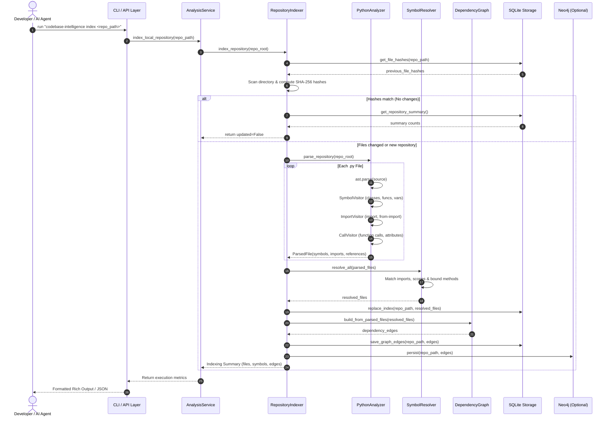

# 🏛️ System Architecture

This document details the architectural design, component decomposition, and execution boundaries of **Codebase Intelligence**.

---

## 1. Architectural Philosophy: Modular Monolith

Codebase Intelligence is designed as an **in-process modular monolith**. Rather than introducing distributed network overhead, message brokers, or multi-container orchestrations for local analysis, it packages all capabilities into cohesive, cleanly isolated layers with strict dependency boundaries.

### Key Architectural Traits

1. **Strict Layer Hierarchy**: Upper layers consume lower layers via typed interfaces; lower layers have zero knowledge of higher layers.
2. **Repository Isolation**: Each analyzed repository receives an isolated database partition (`.codebase-intelligence/repositories/<repo>/<hash>.db`), preventing data pollution across projects.
3. **Dual Graph Engine**: In-memory directed graph execution powered by **NetworkX** for real-time reachability queries, with durable storage in **SQLite** and optional mirror synchronization to **Neo4j**.
4. **Multi-Channel Delivery**: A shared service layer exposes identical business logic across a **Typer/Rich CLI**, an **interactive REPL**, a **FastAPI REST API**, and an **MCP server**.

---

## 2. Component Hierarchy & Layer Breakdown

```mermaid
graph TD
    classDef entry fill:#2d3748,stroke:#4a5568,stroke-width:1px,color:#fff;
    classDef service fill:#1a365d,stroke:#2b6cb0,stroke-width:1px,color:#fff;
    classDef feature fill:#234e52,stroke:#319795,stroke-width:1px,color:#fff;
    classDef core fill:#44337a,stroke:#805ad5,stroke-width:1px,color:#fff;
    classDef analyzer fill:#5f370e,stroke:#d69e2e,stroke-width:1px,color:#fff;
    classDef storage fill:#1c4532,stroke:#38a169,stroke-width:1px,color:#fff;

    subgraph Layer0 ["1. Presentation & Interfaces"]
        CLI["cli.py (Typer / Argparse / Rich REPL)"]:::entry
        API["api/routes.py (FastAPI Routes & Schemas)"]:::entry
        MCP["mcp_server.py (Model Context Protocol Server)"]:::entry
    end

    subgraph Layer1 ["2. Application Service Layer"]
        SVC["services/analysis_service.py (AnalysisService Orchestrator)"]:::service
    end

    subgraph Layer2 ["3. Intelligence & Feature Layer"]
        NAV["features/navigation.py\n(Symbol Search & Details)"]:::feature
        IMP["features/impact_analysis.py\n(Multi-Hop Impact Graph)"]:::feature
        TEST["features/test_selection.py\n(Test Recommendation)"]:::feature
        DEAD["features/dead_code.py\n(Dead Code Heuristics)"]:::feature
        RISK["features/risk_analysis.py\n(Risk Scoring & Heuristics)"]:::feature
        GIT["git_analysis/history.py\n(Git Co-Change & History)"]:::feature
    end

    subgraph Layer3 ["4. Core Intelligence & Graph Engine"]
        MODELS["core/models.py\n(Dataclasses: Symbol, Reference, DependencyEdge)"]:::core
        INDEXER["core/indexing.py\n(RepositoryIndexer & Hash Cache)"]:::core
        RESOLVER["core/resolver.py\n(SymbolResolver: Imports, Calls, Scopes)"]:::core
        GRAPH["core/graph.py\n(DependencyGraph: NetworkX DiGraph)"]:::core
    end

    subgraph Layer4 ["5. AST Parsing Layer"]
        BASE["analyzers/base.py (BaseAnalyzer & Ignore Rules)"]:::analyzer
        PARSER["analyzers/python/parser.py (PythonAnalyzer)"]:::analyzer
        VIS_SYM["analyzers/python/symbols.py (SymbolVisitor)"]:::analyzer
        VIS_IMP["analyzers/python/imports.py (ImportVisitor)"]:::analyzer
        VIS_CALL["analyzers/python/calls.py (CallVisitor)"]:::analyzer
    end

    subgraph Layer5 ["6. Storage & Persistence"]
        DB["storage/database.py (AnalysisDatabase - SQLite)"]:::storage
        GS["storage/graph_store.py (GraphStore - Neo4j / NullStore)"]:::storage
    end

    CLI --> SVC
    API --> SVC
    MCP --> SVC

    SVC --> NAV
    SVC --> IMP
    SVC --> TEST
    SVC --> DEAD
    SVC --> RISK
    SVC --> GIT
    SVC --> INDEXER

    INDEXER --> PARSER
    INDEXER --> RESOLVER
    INDEXER --> GRAPH
    INDEXER --> DB
    INDEXER --> GS

    PARSER --> VIS_SYM
    PARSER --> VIS_IMP
    PARSER --> VIS_CALL
    PARSER --> BASE

    NAV --> DB
    IMP --> DB
    TEST --> DB
    DEAD --> DB
    RISK --> DB
    RISK --> GIT

    RESOLVER --> MODELS
    GRAPH --> MODELS
    DB --> MODELS
```

---

## 3. Detailed Component Responsibilities

### 3.1. Presentation Layer (`cli.py`, `api/routes.py`, `mcp_server.py`)
- **`cli.py`**: Supports both one-off subcommands (`index`, `find`, `symbol`, `impact`, `dead-code`, `tests`, `risk`, `paths`) and an interactive Rich terminal session (`python cli.py interactive`).
- **`api/routes.py`**: Exposes FastAPI endpoints for headless integration, web frontends, and external tooling.
- **`mcp_server.py`**: Implements the Model Context Protocol (MCP) server so that AI assistants can directly query symbols, dependency paths, and impact sets as tools.

### 3.2. Service Layer (`services/analysis_service.py`)
Acts as the central facade and transaction coordinator:
- Binds a specific target repository path to its designated SQLite database.
- Orchestrates multi-step operations (e.g. `clone_and_index`, `analyze_change`).
- Lazily reconstructs the in-memory NetworkX `DependencyGraph` from persisted SQLite edges when graph-reachability queries are requested.

### 3.3. Intelligence Feature Modules (`features/`)
- **`navigation.py`**: Queries symbol definitions, parameter signatures, locations, incoming callers, and outgoing dependencies.
- **`impact_analysis.py`**: Performs reverse-reachability graph traversal (BFS over predecessor edges) to compute blast radius and depth-segmented impact groups.
- **`test_selection.py`**: Maps impacted symbols to candidate test files and test functions using name matching, call paths, and coverage evidence.
- **`dead_code.py`**: Identifies unreferenced functions, classes, and variables with zero incoming resolved references, applying heuristics to filter out entrypoints.
- **`risk_analysis.py`**: Computes composite risk scores (Low/Medium/High) by combining graph reachability depth, git co-change frequency, and unresolved reference ratios.

### 3.4. Core Engine (`core/`)
- **`models.py`**: Domain entities representing code artifacts (`Symbol`, `Import`, `Reference`, `DependencyEdge`, `FileRecord`, `ParsedFile`, `AnalysisFinding`).
- **`indexing.py`**: Top-level scanning engine with SHA-256 content-hash verification to enable incremental indexing skips.
- **`resolver.py`**: High-accuracy symbol binding engine that connects raw AST call sites to resolved global symbol IDs.
- **`graph.py`**: In-memory directed graph wrapper around `networkx.DiGraph` providing shortest path, all-paths, cycle-safe predecessor impact, and neighborhood queries.

### 3.5. Analyzer Layer (`analyzers/`)
- **`base.py`**: Defines standard analyzer protocols and directory exclusion rules (`.git`, `__pycache__`, `.venv`, `node_modules`, `build`, `dist`).
- **`python/`**: Uses Python's native `ast` standard library module. Executes separate visitors for symbols, imports, and calls/attributes, creating a normalized AST inventory per file.

### 3.6. Storage Layer (`storage/`)
- **`database.py`**: Manages isolated SQLite databases, creating relational schema, indexes, parameterized reads, and transactional writes.
- **`graph_store.py`**: Dual-backend graph persistence interface supporting a no-op fallback (`NullGraphStore`) and a property graph engine (`Neo4jGraphStore`).

---

## 4. End-to-End Data Flow

The following sequence illustrates how an analysis request flows through the entire stack:

