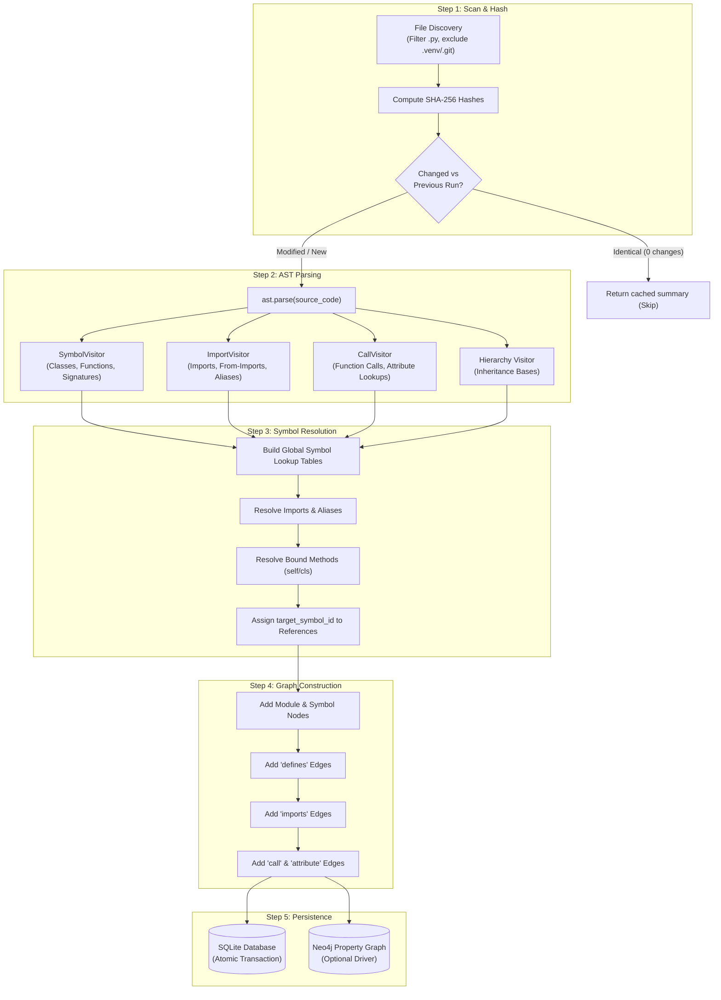
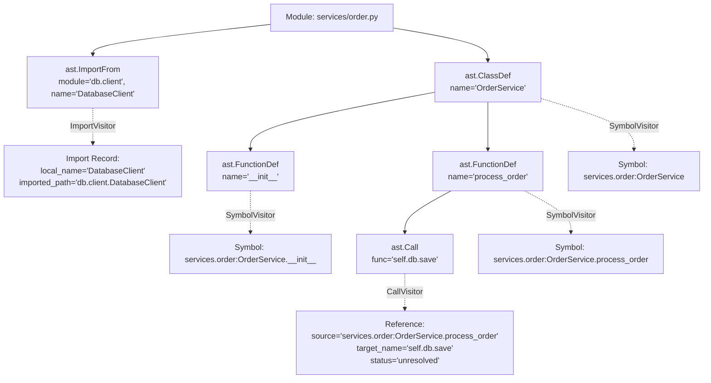
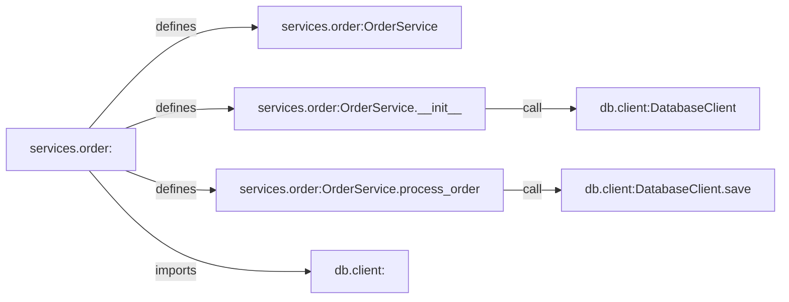

# 🔄 Python Indexer Pipeline & AST Deep Dive

This document details the internal mechanisms of the **Python Indexer Pipeline**, explaining how source code is transformed from raw text into an intelligent, queryable dependency graph through Python's Abstract Syntax Tree (`ast`).

---

## 1. The 5-Step Indexing Pipeline



---

## 2. Step-by-Step Execution Details

### Step 1: Scan & Hash Validation
- Discovers all `.py` files recursively using `Path.rglob("*")`.
- Filters out non-source directories using exclusion patterns: `.git`, `__pycache__`, `.venv`, `venv`, `node_modules`, `.pytest_cache`, `.eggs`, `build`, `dist`.
- Computes chunked **SHA-256 digests** of file contents.
- Compares against previous hashes stored in SQLite. If all hashes match and the repository exists, indexing completes instantaneously without re-parsing.

### Step 2: AST Parsing (`analyzers/python/`)
For each changed file, the source code is parsed into an AST tree using Python's built-in `ast.parse(source, filename=path)`:
1. **Module ID Generation**: Converts relative file paths into dotted module names:
   - `api/routes/matches.py` $\rightarrow$ `api.routes.matches`
   - `matching/__init__.py` $\rightarrow$ `matching`
2. **`SymbolVisitor`** (`ast.NodeVisitor`):
   - Traverses `ClassDef`, `FunctionDef`, `AsyncFunctionDef`, `Assign`, `AnnAssign`.
   - Maintains a `scope_stack` to produce nested qualified names (e.g. `MyClass.my_method`).
   - Uses `ast.unparse(node.args)` to construct readable parameter signatures.
3. **`ImportVisitor`**:
   - Records standard `import foo.bar as baz` (`ast.Import`).
   - Records from-imports `from foo import bar as baz` (`ast.ImportFrom`), computing relative levels (`.` vs `..`).
4. **`CallVisitor`**:
   - Tracks the active enclosing symbol via line-number scoped lookup (`scopes`).
   - Extracts invocation targets from `ast.Call` (e.g., `calculate_total(...)` or `self.service.process(...)`).
   - Extracts dotted attribute accesses from `ast.Attribute`.
5. **Class Hierarchy Walk**:
   - Extracts base class identifiers (`ast.Name` and `ast.Attribute`) to model inheritance.

### Step 3: Symbol Resolution (`core/resolver.py`)
Raw call sites and attribute accesses only contain text strings (e.g., `"get_user"` or `"self.repo.find"`). The **Symbol Resolver** matches these strings to unambiguous global symbol IDs (`module:qualified_name`):

```
Resolution Priority:
1. Direct Symbol ID Match (target_name exists in global symbol table)
2. Bound Method Resolution:
   - If target starts with 'self.' or 'cls.', inspect the enclosing class.
   - Traverse the class inheritance hierarchy to find inherited methods.
3. Import Alias Dereferencing:
   - If target starts with an alias ('np.mean'), map 'np' -> 'numpy' and resolve.
4. Single Local Candidate (unambiguous unqualified match across repository).
5. Same-Module Priority (symbol with matching name declared in the caller's module).
```

### Step 4: Graph Construction (`core/graph.py`)
Transforms resolved symbols and references into a directed graph (`NetworkX.DiGraph`):
- **Nodes**:
  - Module nodes: `api.routes.matches:<module>`
  - Symbol nodes: `api.routes.matches:get_user_matches`
- **Edges & Relationships**:
  - `defines`: Connects module $\rightarrow$ symbols defined within it.
  - `imports`: Connects module $\rightarrow$ imported target modules.
  - `call`: Connects caller symbol $\rightarrow$ callee symbol.
  - `attribute`: Connects source symbol $\rightarrow$ accessed symbol/field.

### Step 5: Persistence (`storage/`)
- Saves records into SQLite within an atomic `with connection:` block.
- Pushes property graph nodes and edges to Neo4j if configured.

---

## 3. Concrete Example: From Python Code to AST & Graph

To see the indexer in action, consider this simple service file `services/order.py`:

```python
# services/order.py
from db.client import DatabaseClient

class OrderService:
    def __init__(self):
        self.db = DatabaseClient()

    def process_order(self, order_id: str) -> bool:
        return self.db.save(order_id)
```

---

### 3.1. What the Python AST Looks Like

When `ast.parse()` parses `process_order`, Python generates an AST tree equivalent to:

```text
FunctionDef(
    name='process_order',
    args=arguments(
        args=[
            arg(arg='self'),
            arg(arg='order_id', annotation=Name(id='str'))
        ]
    ),
    returns=Name(id='bool'),
    body=[
        Return(
            value=Call(
                func=Attribute(
                    value=Attribute(
                        value=Name(id='self'),
                        attr='db'
                    ),
                    attr='save'
                ),
                args=[Name(id='order_id')]
            )
        )
    ],
    lineno=8,
    end_lineno=9
)
```

---

### 3.2. AST Visitors in Action



---

### 3.3. Resolver Step (Connecting References to Target IDs)

The `SymbolResolver` evaluates `OUT_REF`:
1. Source symbol: `services.order:OrderService.process_order`
2. Target name: `self.db.save`
3. Lookup discovers `DatabaseClient.save` in `db.client`.
4. Status transitions from `unresolved` $\rightarrow$ `resolved`:
   - `target_symbol_id` = `"db.client:DatabaseClient.save"`
   - `resolution_status` = `ResolutionStatus.RESOLVED`

---

### 3.4. Final Generated Graph Edges

The graph builder turns this into directed edges:



This graph enables multi-hop queries like:
> *"If `DatabaseClient.save` is modified, what methods are directly impacted?"*  
> Tracing backwards from `DB_SAVE` instantly returns `services.order:OrderService.process_order`.
