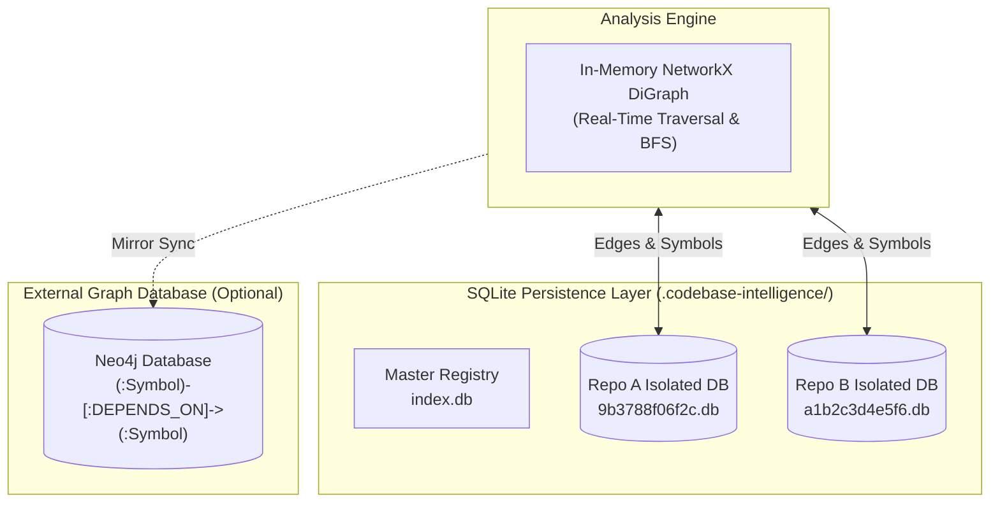
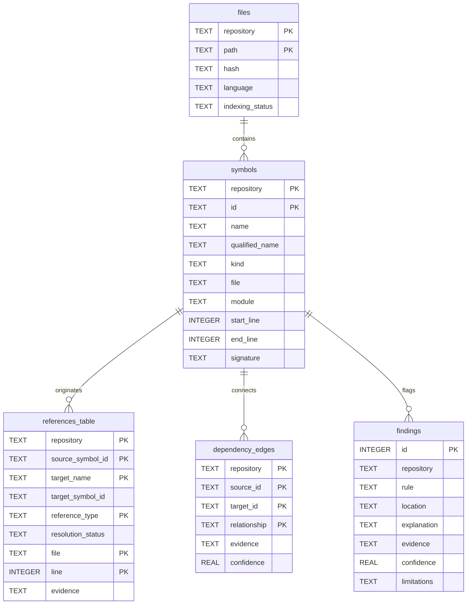

# 💾 Data Persistence & Storage Architecture

This document describes how **Codebase Intelligence** persists, indexes, and queries code structure, symbols, dependency graphs, and static analysis findings.

---

## 1. Storage Architecture Overview

Codebase Intelligence adopts a **hybrid persistence model**:

1. **Primary Durable Store (SQLite)**: Isolated relational databases stored locally on disk under `.codebase-intelligence/`. Requires zero external servers or background daemons.
2. **In-Memory Graph Representation (NetworkX)**: A high-performance directed graph loaded on demand from SQLite edges for fast BFS/DFS path computations.
3. **Optional Property Graph Store (Neo4j)**: An enterprise-grade graph database synchronization layer used when graph clustering or complex Cypher pattern-matching queries are required.



---

## 2. Directory Layout & Repository Isolation

To ensure that indexing one project never corrupts, slows down, or pollutes queries for another project, each repository is assigned its own SQLite database file:

```text
d:\code\Golang\Codebase-Intelligence\
└── .codebase-intelligence/
    ├── index.db                       # Master registry (used by FastAPI routes)
    └── repositories/
        ├── belong-api/
        │   └── 9b3788f06f2c.db        # belong-api database (1.6 MB)
        ├── Anchor/
        │   └── 3f8a12e9b04d.db        # Anchor database
        └── Vision/
            └── 7c2d91ea4410.db        # Vision database
```

### Hash-Based Partitioning
The database filename is determined by hashing the normalized absolute path of the target repository:
```python
repo_name = re.sub(r"[^A-Za-z0-9._-]+", "_", repo_root.name) or "repository"
repo_key = hashlib.sha256(str(repo_root).encode("utf-8")).hexdigest()[:12]
db_path = Path(".codebase-intelligence") / "repositories" / repo_name / f"{repo_key}.db"
```
This guarantees deterministic database location and safe concurrent indexing across distinct workspaces.

---

## 3. SQLite Relational Schema

Every repository database contains five core tables and three performance indexes:



---

### 3.1. Table Definitions & Schemas

#### 1. `files` (File Tracking & Cache Invalidation)
Tracks all scanned source files and their cryptographic content hashes to power incremental indexing.
```sql
CREATE TABLE IF NOT EXISTS files (
    repository TEXT NOT NULL,
    path TEXT NOT NULL,
    hash TEXT NOT NULL,
    language TEXT NOT NULL,
    indexing_status TEXT NOT NULL,
    PRIMARY KEY (repository, path)
);
```

#### 2. `symbols` (Code Entity Declarations)
Stores all classes, methods, functions, and module-level variables with their exact line boundaries and signatures.
```sql
CREATE TABLE IF NOT EXISTS symbols (
    repository TEXT NOT NULL,
    id TEXT NOT NULL,
    name TEXT NOT NULL,
    qualified_name TEXT NOT NULL,
    kind TEXT NOT NULL,           -- class, function, async_function, variable
    file TEXT NOT NULL,
    module TEXT NOT NULL,
    start_line INTEGER NOT NULL,
    end_line INTEGER NOT NULL,
    signature TEXT,
    PRIMARY KEY (repository, id)
);
```

#### 3. `references_table` (Call Sites & Import References)
Stores every raw symbol reference extracted from AST call sites, attribute accesses, and import statements.
```sql
CREATE TABLE IF NOT EXISTS references_table (
    repository TEXT NOT NULL,
    source_symbol_id TEXT NOT NULL,
    target_name TEXT NOT NULL,
    target_symbol_id TEXT,        -- NULL if unresolved, populated upon resolution
    reference_type TEXT NOT NULL, -- call, attribute, import
    resolution_status TEXT NOT NULL, -- resolved, unresolved, ambiguous
    file TEXT NOT NULL,
    line INTEGER NOT NULL,
    evidence TEXT NOT NULL,       -- JSON payload
    PRIMARY KEY (
        repository, source_symbol_id, target_name,
        reference_type, file, line
    )
);
```

#### 4. `dependency_edges` (Resolved Graph Edges)
Stores directed edges connecting symbols and modules to form the persistent dependency graph.
```sql
CREATE TABLE IF NOT EXISTS dependency_edges (
    repository TEXT NOT NULL,
    source_id TEXT NOT NULL,
    target_id TEXT NOT NULL,
    relationship TEXT NOT NULL,   -- defines, imports, call, attribute, depends_on
    evidence TEXT NOT NULL,       -- JSON list of occurrence evidence
    confidence REAL NOT NULL,     -- 0.0 to 1.0 confidence score
    PRIMARY KEY (repository, source_id, target_id, relationship)
);
```

#### 5. `findings` (Static Analysis Findings & Dead Code)
Stores intelligence warnings such as dead code candidates and unreferenced symbols.
```sql
CREATE TABLE IF NOT EXISTS findings (
    id INTEGER PRIMARY KEY AUTOINCREMENT,
    repository TEXT NOT NULL,
    rule TEXT NOT NULL,
    location TEXT NOT NULL,
    explanation TEXT NOT NULL,
    evidence TEXT NOT NULL,       -- JSON payload
    confidence REAL NOT NULL,
    limitations TEXT NOT NULL     -- JSON list of limitations
);
```

---

### 3.2. Performance Indexes
Fast symbol lookups and reverse caller queries are optimized through dedicated composite indexes:
```sql
-- Fast lookups of all symbols within a specific file
CREATE INDEX IF NOT EXISTS idx_symbols_file ON symbols(repository, file);

-- Fast substring and exact matching for symbol searches
CREATE INDEX IF NOT EXISTS idx_symbols_name ON symbols(repository, name);

-- Rapid caller lookups (who calls this target symbol?)
CREATE INDEX IF NOT EXISTS idx_edges_target ON dependency_edges(repository, target_id);
```

---

## 4. Transaction Management & Atomicity

Database writes during indexing are wrapped in Python's SQLite transaction context (`with self._connection:`). If an error occurs during parsing or edge construction:
- The transaction **rolls back completely**, preventing partial or corrupted indexing states.
- Re-indexing uses `replace_index()` to cleanly flush old symbols and references before inserting new ones.

---

## 5. Optional Neo4j Graph Synchronization

When environment variables `NEO4J_URI` and `NEO4J_PASSWORD` are defined, the system activates `Neo4jGraphStore` (`storage/graph_store.py`).

### Neo4j Data Model
- **Nodes**: Labeled `:Symbol` with properties `{id: string, repository: string}`.
- **Relationships**: Typed `[:DEPENDS_ON]` with properties `{relationship: string, repository: string, confidence: float, evidence: string}`.

### Persistence Query (Cypher)
```cypher
MATCH (n {repository: $repository}) DETACH DELETE n;

MERGE (source:Symbol {id: $source_id, repository: $repository})
MERGE (target:Symbol {id: $target_id, repository: $repository})
MERGE (source)-[r:DEPENDS_ON {
    relationship: $relationship, 
    repository: $repository, 
    confidence: $confidence, 
    evidence: $evidence
}]->(target)
RETURN count(r);
```

### Graph Path Query (Cypher)
```cypher
MATCH p = shortestPath(
    (source:Symbol {repository: $repository, id: $source})
    -[:DEPENDS_ON*1..$cutoff]->
    (target:Symbol {repository: $repository, id: $target})
)
RETURN [n in nodes(p) | n.id] as path;
```
If Neo4j is not configured, the application automatically uses `NullGraphStore` and relies on the local in-memory NetworkX engine.
