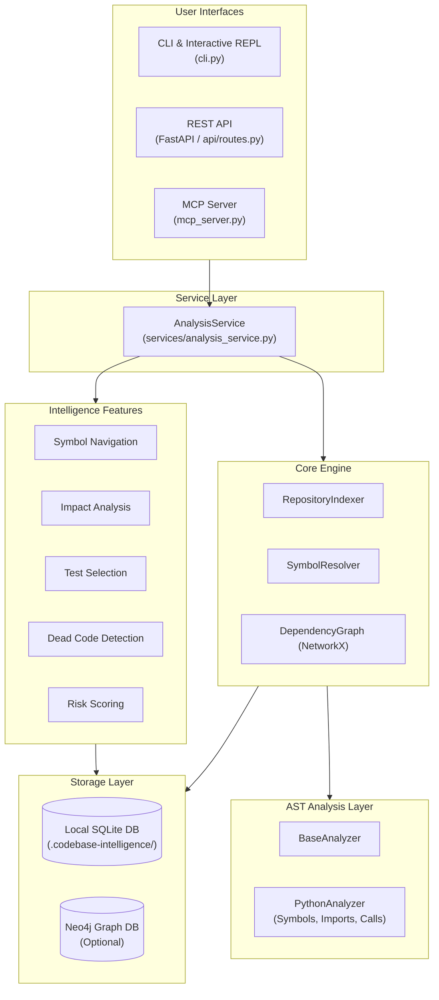

# 📚 Codebase Intelligence Documentation

Welcome to the comprehensive technical documentation for **Codebase Intelligence**, a local developer tool and static analysis engine that extracts dependency graphs and intelligence metrics from Python codebases.

---

## 📑 Documentation Index

| Document | Topic | Description |
| :--- | :--- | :--- |
| [**1. System Architecture**](file:///d:/code/Golang/Codebase-Intelligence/docs/01_system_architecture.md) | High-Level Architecture | Component decomposition, modular layers, data flows, and interactive interfaces (CLI, REST API, MCP). |
| [**2. Python Indexer Pipeline & AST Flow**](file:///d:/code/Golang/Codebase-Intelligence/docs/02_indexer_pipeline_and_ast.md) | Indexer Deep Dive | Step-by-step pipeline walkthrough, AST visitors, symbol resolution algorithms, and end-to-end AST code examples. |
| [**3. Data Persistence & Storage**](file:///d:/code/Golang/Codebase-Intelligence/docs/03_data_persistence_and_storage.md) | Persistence Layer | SQLite relational schema, per-repository database isolation, indexing transactions, and optional Neo4j graph store synchronization. |

---

## 🧭 System Overview at a Glance

