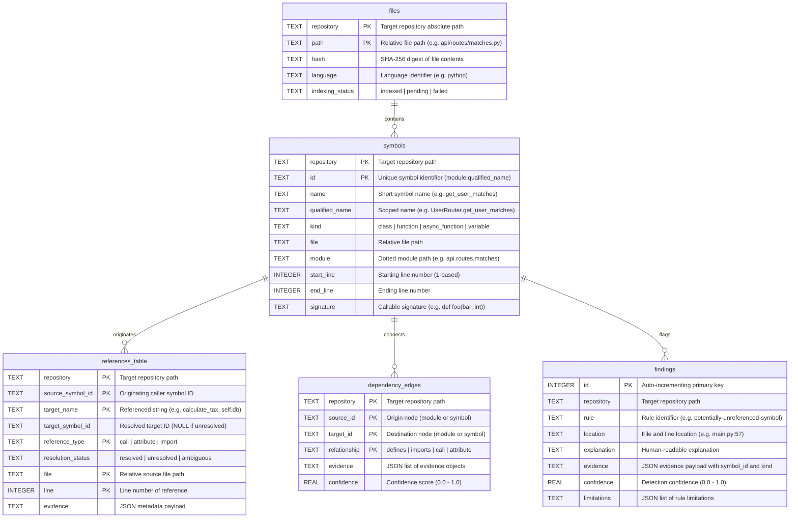

# 🗄️ Database Schema & Storage Architecture

This document provides a complete reference for the **Codebase Intelligence SQLite Database Schema**, explaining where databases live, how repositories are isolated, and the exact table structures, columns, constraints, and indexes.

---

## 1. Storage Location & Architecture

Codebase Intelligence uses a **partitioned SQLite storage model**:

```text
D:\code\Golang\Codebase-Intelligence\
└── .codebase-intelligence\
    ├── index.db                       # Unused default shell (0 rows)
    └── repositories\                  # 📂 Isolated repository storage root
        ├── belong-api\                # 📂 Name of analyzed repository
        │   └── 9b3788f06f2c.db        # 💾 Dedicated SQLite DB (1.6 MB)
        ├── Anchor\
        │   └── 3f8a12e9b04d.db        # 💾 Dedicated SQLite DB for Anchor
        └── Vision\
            └── 7c2d91ea4410.db        # 💾 Dedicated SQLite DB for Vision
```

### 🔑 Deterministic Hash Naming
The database file name (e.g., `9b3788f06f2c.db`) is generated by hashing the absolute repository path:
```python
repo_name = re.sub(r"[^A-Za-z0-9._-]+", "_", repo_root.name) or "repository"
repo_key = hashlib.sha256(str(repo_root).encode("utf-8")).hexdigest()[:12]
db_path = Path(".codebase-intelligence") / "repositories" / repo_name / f"{repo_key}.db"
```
- ✅ **Zero cross-repo contamination**: Indexing Project B will never overwrite or slow down queries for Project A.
- ✅ **Zero external dependencies**: Standard SQLite file, viewable with any GUI tool (e.g. DB Browser for SQLite, DBeaver, VS Code SQLite extensions).

---

## 2. Entity-Relationship (ER) Diagram



---

## 3. Table Specifications & Real Examples

### 3.1. `files` Table
Tracks every source file discovered in the repository, along with its SHA-256 content hash to enable **instant incremental indexing**.

```sql
CREATE TABLE IF NOT EXISTS files (
    repository TEXT NOT NULL,
    path TEXT NOT NULL,
    hash TEXT NOT NULL,
    language TEXT NOT NULL,
    indexing_status TEXT NOT NULL,
    PRIMARY KEY (repository, path)
);
```

| Column | Type | Nullable | Description | Example (`belong-api`) |
| :--- | :--- | :---: | :--- | :--- |
| `repository` | `TEXT` | ❌ No | Repository root path | `D:/code/Golang/Belong/belong-api` |
| `path` | `TEXT` | ❌ No | File path relative to repository | `api/routes/matches.py` |
| `hash` | `TEXT` | ❌ No | SHA-256 digest of file content | `f08a7f51794f940b766f2af...` |
| `language` | `TEXT` | ❌ No | Source code language | `python` |
| `indexing_status` | `TEXT` | ❌ No | Status enum (`indexed`, `pending`, `failed`) | `indexed` |

---

### 3.2. `symbols` Table
Stores all parsed definitions: modules, classes, functions, asynchronous functions, methods, and variables.

```sql
CREATE TABLE IF NOT EXISTS symbols (
    repository TEXT NOT NULL,
    id TEXT NOT NULL,
    name TEXT NOT NULL,
    qualified_name TEXT NOT NULL,
    kind TEXT NOT NULL,
    file TEXT NOT NULL,
    module TEXT NOT NULL,
    start_line INTEGER NOT NULL,
    end_line INTEGER NOT NULL,
    signature TEXT,
    PRIMARY KEY (repository, id)
);
```

| Column | Type | Nullable | Description | Example (`belong-api`) |
| :--- | :--- | :---: | :--- | :--- |
| `repository` | `TEXT` | ❌ No | Repository root path | `D:/code/Golang/Belong/belong-api` |
| `id` | `TEXT` | ❌ No | Globally unique symbol identifier | `api.routes.embeddings:generate_profile_embeddings` |
| `name` | `TEXT` | ❌ No | Unqualified name | `generate_profile_embeddings` |
| `qualified_name`| `TEXT` | ❌ No | Scope-qualified name | `generate_profile_embeddings` |
| `kind` | `TEXT` | ❌ No | AST type (`class`, `function`, `async_function`, `variable`) | `async_function` |
| `file` | `TEXT` | ❌ No | File path containing definition | `api/routes/embeddings.py` |
| `module` | `TEXT` | ❌ No | Dotted module identifier | `api.routes.embeddings` |
| `start_line` | `INTEGER` | ❌ No | 1-based start line | `18` |
| `end_line` | `INTEGER` | ❌ No | 1-based end line | `48` |
| `signature` | `TEXT` | ✅ Yes | Python argument signature | `async def generate_profile_embeddings(user_id: UUID)` |

---

### 3.3. `references_table` Table
Captures every reference site in the code: function invocations (`call`), dotted lookups (`attribute`), and import statements (`import`).

```sql
CREATE TABLE IF NOT EXISTS references_table (
    repository TEXT NOT NULL,
    source_symbol_id TEXT NOT NULL,
    target_name TEXT NOT NULL,
    target_symbol_id TEXT,
    reference_type TEXT NOT NULL,
    resolution_status TEXT NOT NULL,
    file TEXT NOT NULL,
    line INTEGER NOT NULL,
    evidence TEXT NOT NULL,
    PRIMARY KEY (
        repository, source_symbol_id, target_name,
        reference_type, file, line
    )
);
```

| Column | Type | Nullable | Description | Example (`belong-api`) |
| :--- | :--- | :---: | :--- | :--- |
| `repository` | `TEXT` | ❌ No | Repository path | `D:/code/Golang/Belong/belong-api` |
| `source_symbol_id` | `TEXT` | ❌ No | Enclosing caller symbol ID | `api.routes.embeddings:generate_profile_embeddings` |
| `target_name` | `TEXT` | ❌ No | Raw target name in AST | `ProfileRepository.get_profile` |
| `target_symbol_id` | `TEXT` | ✅ Yes | Resolved target ID | `profile.repository:ProfileRepository.get_profile` |
| `reference_type` | `TEXT` | ❌ No | Reference kind (`call`, `attribute`, `import`) | `call` |
| `resolution_status`| `TEXT` | ❌ No | Status (`resolved`, `unresolved`, `ambiguous`) | `resolved` |
| `file` | `TEXT` | ❌ No | Call site file path | `api/routes/embeddings.py` |
| `line` | `INTEGER` | ❌ No | Call site line number | `19` |
| `evidence` | `TEXT` | ❌ No | JSON metadata | `{}` |

---

### 3.4. `dependency_edges` Table
The resolved directed graph. These edges are reconstructed into an in-memory **NetworkX DiGraph** for fast traversal (reachability, blast radius, shortest paths).

```sql
CREATE TABLE IF NOT EXISTS dependency_edges (
    repository TEXT NOT NULL,
    source_id TEXT NOT NULL,
    target_id TEXT NOT NULL,
    relationship TEXT NOT NULL,
    evidence TEXT NOT NULL,
    confidence REAL NOT NULL,
    PRIMARY KEY (repository, source_id, target_id, relationship)
);
```

| Column | Type | Nullable | Description | Example (`belong-api`) |
| :--- | :--- | :---: | :--- | :--- |
| `repository` | `TEXT` | ❌ No | Repository path | `D:/code/Golang/Belong/belong-api` |
| `source_id` | `TEXT` | ❌ No | Origin node ID | `api.routes.embeddings:<module>` |
| `target_id` | `TEXT` | ❌ No | Destination node ID | `api.routes.embeddings:generate_profile_embeddings` |
| `relationship` | `TEXT` | ❌ No | Relationship type (`defines`, `imports`, `call`, `attribute`) | `defines` |
| `evidence` | `TEXT` | ❌ No | JSON array of occurrence locations | `{"raw": [{"file": "api/routes/embeddings.py"}]}` |
| `confidence` | `REAL` | ❌ No | Resolution confidence (0.0 - 1.0) | `1.0` |

---

### 3.5. `findings` Table
Stores static analysis warnings produced by features like dead code detection.

```sql
CREATE TABLE IF NOT EXISTS findings (
    id INTEGER PRIMARY KEY AUTOINCREMENT,
    repository TEXT NOT NULL,
    rule TEXT NOT NULL,
    location TEXT NOT NULL,
    explanation TEXT NOT NULL,
    evidence TEXT NOT NULL,
    confidence REAL NOT NULL,
    limitations TEXT NOT NULL
);
```

| Column | Type | Nullable | Description | Example (`belong-api`) |
| :--- | :--- | :---: | :--- | :--- |
| `id` | `INTEGER` | ❌ No | Primary key (auto-increment) | `1` |
| `repository` | `TEXT` | ❌ No | Repository path | `D:/code/Golang/Belong/belong-api` |
| `rule` | `TEXT` | ❌ No | Analysis rule name | `potentially-unreferenced-symbol` |
| `location` | `TEXT` | ❌ No | File and line location | `matching/compatibility.py:162` |
| `explanation` | `TEXT` | ❌ No | Finding explanation | `function 'llm_reasoning_node' has no resolved incoming reference in the static index.` |
| `evidence` | `TEXT` | ❌ No | JSON evidence object | `{"symbol_id": "matching.compatibility:llm_reasoning_node", "kind": "function"}` |
| `confidence` | `REAL` | ❌ No | Confidence score (0.65 for dead code heuristics) | `0.65` |
| `limitations` | `TEXT` | ❌ No | JSON array of known caveats | `["Dynamic calls, framework registration, decorators..."]` |

---

## 4. Performance Indexes

Three indexes are maintained automatically to guarantee sub-millisecond query performance:

```sql
-- 1. Fast lookup of all symbols declared inside a specific file:
CREATE INDEX IF NOT EXISTS idx_symbols_file 
ON symbols(repository, file);

-- 2. Fast substring and exact matching for CLI/API symbol searches:
CREATE INDEX IF NOT EXISTS idx_symbols_name 
ON symbols(repository, name);

-- 3. Reverse caller lookup: "Who calls this function?"
CREATE INDEX IF NOT EXISTS idx_edges_target 
ON dependency_edges(repository, target_id);
```

---

## 5. Useful SQL Queries for Inspection

You can run these queries directly in any SQLite viewer connected to your `.db` file:

### 1. Count rows across all tables:
```sql
SELECT 'files' AS tbl, COUNT(*) AS count FROM files
UNION ALL
SELECT 'symbols', COUNT(*) FROM symbols
UNION ALL
SELECT 'references_table', COUNT(*) FROM references_table
UNION ALL
SELECT 'dependency_edges', COUNT(*) FROM dependency_edges
UNION ALL
SELECT 'findings', COUNT(*) FROM findings;
```

### 2. Find all methods on a class:
```sql
SELECT name, kind, start_line, end_line, signature 
FROM symbols 
WHERE qualified_name LIKE 'OrderService.%';
```

### 3. Find who calls a specific function:
```sql
SELECT source_id, relationship, confidence 
FROM dependency_edges 
WHERE target_id = 'tax:calculate_vat';
```

### 4. Find all unresolved call sites:
```sql
SELECT source_symbol_id, target_name, file, line 
FROM references_table 
WHERE resolution_status = 'unresolved' AND reference_type = 'call';
```
