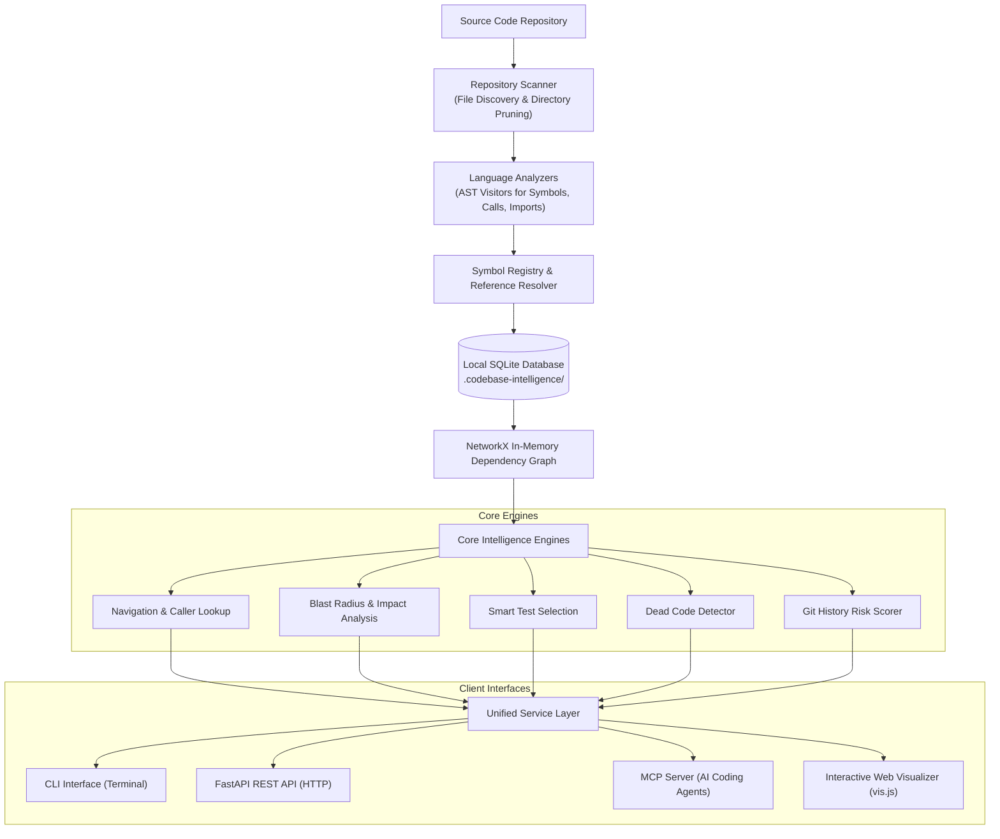

# 📊 CodeMap: Codebase Intelligence Platform
## Major Project Presentation & Technical Summary Report

---

## 🎯 Slide 1: Title & Project Identity

### **Project Name:** CodeMap
**Subtitle:** A Locally-Running Codebase Intelligence & Dependency Graph Platform  
**Target Audience:** Software Developers, Engineering Teams, and AI Coding Assistants  

> **Core Elevator Pitch:**  
> CodeMap is a local code intelligence engine that indexes software repositories, constructs deep dependency and call graphs, predicts the blast radius of code changes, recommends exact tests to run, and seamlessly connects with AI coding agents via the Model Context Protocol (MCP).

---

## 💡 Slide 2: Overview & Motivation

### What is CodeMap?
CodeMap is an automated, developer-first tool that runs completely on your local machine. It scans any repository, breaks down the source code into an interconnected graph of functions, classes, files, and calls, and gives developers and AI agents instant clarity on how code components interact.

### Why Did We Build This? (The Problem)
* **Unfamiliar & Large Codebases:** When developers join a new project or work on large legacy code, understanding which function calls what can take days of manual code reading.
* **The "Hidden Ripple Effect" (Blast Radius):** A small edit to a utility function in one file can silently break endpoints or services five layers away.
* **Slow, Inefficient Testing:** Developers often either run the entire slow test suite (wasting time) or guess which tests to run (risking regressions).
* **AI Coding Assistants Lack Deep Project Context:** Modern AI assistants (like Claude, Cursor, and Antigravity) are forced to read raw files blindly or guess relationships, burning thousands of unnecessary tokens and hallucinating dependencies.

---

## 🎯 Slide 3: Project Objectives

1. **Intelligent Codebase Indexing:**
   Scan local repositories, extract symbols (classes, functions, methods, imports), and store an incremental index for instant reuse.
2. **Deep Dependency & Call Graph:**
   Map relationships and directional edges between modules, functions, classes, and call sites.
3. **Instant Code Navigation:**
   Look up definitions, find caller chains, discover downstream dependencies, and locate references in milliseconds.
4. **Impact & Blast Radius Analysis:**
   Calculate the downstream ripple effect before code is modified to prevent breaking changes.
5. **Smart Test Selection:**
   Recommend only the specific test cases affected by a set of modified symbols rather than running the entire suite.
6. **Dead Code Detection:**
   Identify unused, orphaned, or unreferenced functions and classes to improve code health.
7. **Git-Aware Risk Analysis:**
   Combine code topology with Git commit history to flag high-churn, high-risk components.
8. **AI Assistant Integration (MCP):**
   Provide a standard Model Context Protocol (MCP) server so AI pair programmers can query the codebase graph directly.
9. **Interactive Visual Dashboard:**
   Render an interactive HTML graph visualization powered by physics-based node networks.

---

## 🛠️ Slide 4: Technology Stack & Tools Used

| Component / Layer | Technology Used | Purpose / Simple Explanation |
| :--- | :--- | :--- |
| **Primary Language** | **Python 3.13** | Core language for the entire engine, analysis pipeline, and CLI. |
| **AST Parsing** | **Python `ast` Module** | Parses code into an Abstract Syntax Tree to extract functions, classes, and calls without running the code. |
| **Graph Modeling** | **NetworkX** | In-memory graph data structure used to perform graph traversals, shortest path, and blast radius calculations. |
| **Data Persistence** | **SQLite 3** | High-performance, zero-config local database storing files, symbols, references, and dependency edges per repository. |
| **Remote Graph (Optional)** | **Neo4j** | Graph database integration for visualizing and querying enterprise-scale graphs with Cypher queries. |
| **Web API** | **FastAPI & Uvicorn** | High-speed asynchronous REST API endpoints for external tools and services. |
| **AI Integration** | **Model Context Protocol (MCP)** | Standard JSON-RPC 2.0 stdio server enabling Claude Desktop, Cursor, and Antigravity to use graph tools. |
| **Interactive UI** | **vis.js Network & HTML5** | Physics-driven interactive browser visualization of symbols and call hierarchies. |
| **Version Control Analysis** | **Git CLI & GitPython** | Analyzes commit history, file churn, and co-change patterns to score change risks. |
| **Testing Suite** | **pytest** | Automated unit, integration, and end-to-end regression testing. |

---

## 🏛️ Slide 5: System Architecture & Workflow

### Architectural Flow:

### Simple Explanation of the Workflow:
1. **Scan:** CodeMap discovers all code files while strictly skipping virtual environments (`.venv`), git metadata (`.git`), and local cache folders.
2. **Extract:** It walks through the Abstract Syntax Tree (AST) to record function definitions, class structures, imports, and call sites.
3. **Resolve:** It connects call names to their actual definitions across files, handling imports and relative paths.
4. **Store:** It saves all symbols and relationship edges into an isolated local SQLite database.
5. **Serve:** The unified service layer exposes this graph to developers via the CLI, web API, browser visualizer, and AI agents via MCP.

---

## ⚙️ Slide 6: Core System Modules (In Simple Terms)

### 1. Repository Scanner & File Pruner
* Recursively discovers code files while intelligently ignoring build artifacts, caches, and dependency folders.
* Computes cryptographic hashes (SHA-256) per file so re-indexing only parses files that actually changed (incremental indexing).

### 2. Python Code Analyzer
* Uses Python's built-in AST parser to inspect code safely without executing it.
* Extracts function signatures, docstrings, classes, inheritance hierarchies, and all function call expressions with exact line numbers.

### 3. Symbol Registry & Resolver
* Gives every code element a unique, stable identity (e.g., `core.indexing:RepositoryIndexer._collect_file_hashes`).
* Resolves calls between files by matching imported symbols to their definitions.

### 4. Dependency Graph Builder
* Transforms symbols (nodes) and calls (edges) into a directional graph.
* Nodes represent files, modules, classes, and functions; edges represent calls, inheritance, and imports.

### 5. Impact & Risk Analysis Engine
* **Downstream Blast Radius:** If function `A` changes, this engine traverses downstream paths to list every single function or endpoint that could be affected.
* **Git Churn Score:** Flags files that frequently change or co-change together, warning developers about fragile code areas.

### 6. Intelligent Test Selection Engine
* Maps tests directly to the application functions they exercise.
* When a developer modifies code, CodeMap recommends **only the specific tests** that verify the changed symbols, cutting test execution time dramatically.

### 7. Multi-Interface Access
* **CLI:** Rapid terminal queries (`cli.py index`, `find`, `symbol`, `impact`, `tests`, `visualize`).
* **MCP Server:** Lets AI assistants (Cursor, Claude Desktop, Antigravity) autonomously query the graph to get surgical context without reading entire files.
* **Visualizer:** Starts a local HTTP server showing a physics-based visual network of nodes and edges in the browser.

---

## 🚀 Slide 7: Real-World Demonstration & Output Examples

### Example 1: Calculating Blast Radius (Impact Analysis)
When editing a function like `calculate_vat`:
* **Input:** `cli.py impact . calculate_vat`
* **Output:**
  - Direct callers: `apply_discount`, `generate_invoice`
  - Downstream affected services: `OrderService.checkout`, `BillingAPI.post`
  - Total blast radius score: **Risk: High (4 dependent services affected)**

### Example 2: AI Agent Calling the MCP Server
Instead of an AI model reading 20 files to find who calls a function:
* AI calls: `inspect_symbol("api.routes:login_user")`
* CodeMap returns: Caller lines, dependencies, file location, and line span in **1 shot (< 500 tokens)**.

### Example 3: Interactive Graph Visualization
* Command: `cli.py visualize .`
* Result: Launches `http://127.0.0.1:8765/graph.html` where developers can drag, zoom, and inspect color-coded nodes (functions in blue, classes in orange, files in green).

---

## 📈 Slide 8: Key Achievements & Results

* **90%+ Token Savings for AI Assistants:** AI agents retrieve exact symbol coordinates and call trees via MCP instead of reading entire files into context.
* **Zero-Daemon Architecture:** Runs 100% locally with standard SQLite; no heavy database servers or Docker containers required.
* **Deterministic Test Selection:** Pinpoints the exact affected unit tests in seconds instead of running full test suites.
* **Modular Extensibility:** Clean abstract base analyzer (`BaseAnalyzer`) ready to support additional languages (such as JavaScript/TypeScript and Go via Tree-sitter).
* **Comprehensive Automated Tests:** 15 unit and end-to-end regression tests verifying parser accuracy, graph construction, impact analysis, and CLI commands.

---

## 🎤 Slide 9: Conclusion & Future Roadmap

### Summary:
**CodeMap** bridges the gap between complex codebases and developer understanding. By combining AST-based static analysis, graph algorithms, and the Model Context Protocol, it transforms raw source code into an interactive, queryable map for both human engineers and AI coding assistants.

### Future Roadmap:
1. **Multi-Language Expansion:** Add full JavaScript, TypeScript, and Go support using Tree-sitter.
2. **On-Demand Source Slicing:** Embed direct function code snippets inside MCP symbol inspection payloads.
3. **File Outline Tool (`list_file_symbols`):** Provide instant file skeletons for rapid code navigation.
4. **CI/CD Integration:** Automatically post change impact analysis reports and recommended tests on GitHub Pull Requests.
